# Antigravity (AGY) & Cloud Shell Session History Log

This document records the complete chronological session history of the Antigravity (AGY) agent (`conversation_id: db4787c0-201a-4eff-98db-2818c14a6f98`) and Cloud Shell terminal operations used to complete the challenge lab **"Evaluating and Hill Climbing a Generative AI Agent Using Autoraters"** in project `qwiklabs-gcp-04-b7f0419c6ef3`.

---

## Session Metadata

| Field | Value |
| :--- | :--- |
| **AGY Conversation ID** | `db4787c0-201a-4eff-98db-2818c14a6f98` |
| **Active Workspace** | `/home/student_04_abad9f02386c` |
| **Lab Directory** | `/home/student_04_abad9f02386c/autoraters` |
| **Student Account** | `student-04-abad9f02386c@qwiklabs.net` |
| **GCP Project ID** | `qwiklabs-gcp-04-b7f0419c6ef3` |
| **GCS Bucket** | `gs://qwiklabs-gcp-04-b7f0419c6ef3-bucket` |
| **Session Date** | `2026-10-29` |

---

## Chronological Execution Timeline

```mermaid
flowchart LR
    P1["Phase 1 (10:21Z)<br/>Auth Pre-Flight &<br/>GCS Codebase Download"]
    P2["Phase 2 (10:22Z–10:23Z)<br/>Python 3.13.16 Provisioning<br/>via uv + .env Setup"]
    P3["Phase 3 (10:24Z–10:26Z)<br/>Codebase Inspection &<br/>Batch EvalSet Generation"]
    P4["Phase 4 (10:26Z–10:28Z)<br/>Baseline Multi-Pass Eval<br/>(k=5, 19 Criteria)"]
    P5["Phase 5 (10:28Z–10:29Z)<br/>19-Criterion Consistency<br/>Analysis & GCS Upload"]
    P6["Phase 6 (10:29Z–10:36Z)<br/>Skill Hill Climbing &<br/>Mean 5.0000 Verification"]
    P7["Phase 7 (10:38Z–10:53Z)<br/>HLD/LLD/Runbook Creation<br/>& GitHub Repository Push"]

    P1 --> P2 --> P3 --> P4 --> P5 --> P6 --> P7
```



---

## Detailed Step-by-Step Session Log

### Phase 1: Mandatory GCP Authentication Pre-Flight & Codebase Download (`10:21:54Z – 10:22:18Z`)

1. **Skill Activation (`google-cloud-auth-verification` & `enforcing-resource-attribution`)**:
   - Read `/home/student_04_abad9f02386c/.gemini/skills/google-cloud-auth-verification/SKILL.md` and `/home/student_04_abad9f02386c/.gemini/skills/enforcing-resource-attribution/SKILL.md`.
2. **Environment & Credential Verification**:
   - Executed `gcloud auth list`, `gcloud config get-value project`, and `gcloud storage ls`.
   - Verified active identity `student-04-abad9f02386c@qwiklabs.net`, active project `qwiklabs-gcp-04-b7f0419c6ef3`, and bucket `gs://qwiklabs-gcp-04-b7f0419c6ef3-bucket/`.
3. **Codebase Download**:
   - Executed:
     ```bash
     gcloud storage cp -r gs://qwiklabs-gcp-04-b7f0419c6ef3-bucket/autoraters /home/student_04_abad9f02386c/
     gcloud config set project qwiklabs-gcp-04-b7f0419c6ef3
     ```
   - Downloaded 26 files (`3.4 MiB`) into `/home/student_04_abad9f02386c/autoraters/`.

---

### Phase 2: Python 3.13 Provisioning & `.env` Setup (`10:22:22Z – 10:23:55Z`)

1. **Dependency Inspection (`managing-python-dependencies`)**:
   - Read `/home/student_04_abad9f02386c/autoraters/requirements.txt`.
   - Identified critical constraint: `krippendorff-aleph-alpha==0.1.17` requires `Python >= 3.13`, whereas the default system Python in Cloud Shell was `Python 3.12.3`.
2. **Fast Python 3.13 Provisioning via `uv`**:
   - Rather than compiling Python 3.13 from C source via `pyenv install 3.13` (which takes 5–10 minutes), checked `/usr/local/bin/uv` (`uv 0.10.9`) and created a Python 3.13 virtual environment in seconds:
     ```bash
     cd /home/student_04_abad9f02386c/autoraters
     uv venv --python 3.13 --seed .venv
     uv pip install --python .venv/bin/python -r requirements.txt
     ```
   - Installed 162 packages into `/home/student_04_abad9f02386c/autoraters/.venv` (`CPython 3.13.16`).
   - Added `/home/student_04_abad9f02386c/autoraters/.venv/bin` to `~/.bashrc` so interactive shells and subprocesses automatically resolve `python3`, `pip`, and `adk` to Python 3.13.16.
3. **Configuration File Creation (`.env`)**:
   - Created `/home/student_04_abad9f02386c/autoraters/.env`:
     ```env
     GOOGLE_GENAI_USE_VERTEXAI=TRUE
     GOOGLE_CLOUD_PROJECT=qwiklabs-gcp-04-b7f0419c6ef3
     GOOGLE_CLOUD_LOCATION=global
     MODEL=gemini-3.5-flash
     ```

---

### Phase 3: Codebase Analysis & Task 3 Batch Response Generation (`10:24:00Z – 10:26:15Z`)

1. **Codebase Inspection**:
   - Read all files in `eval_harness/` (`create_re_agent_evalset.py`, `run_geap_eval.py`, `run_hillclimb.py`, `all_criteria_analysis.py`, `single_criterion_analysis.py`, `explain_criteria_results.py`, `metrics_calc.py`, `utils.py`, `rubrics.json`, `hillclimb_lots.txt`).
   - Read all files in `re_analyst/` (`agent.py`, `tools/lot_tool.py`, `tools/tax_tool.py`, and the 3 `SKILL.md` files under `re_analyst/skills/`).
2. **Task 3 Execution (`eval_harness.create_re_agent_evalset`)**:
   - Executed:
     ```bash
     cd /home/student_04_abad9f02386c/autoraters
     .venv/bin/python -m eval_harness.create_re_agent_evalset \
       --lots-file eval_harness/hillclimb_lots.txt \
       --out re_analyst/hillclimb_lots.evalset.json \
       --agent-dir ./re_analyst
     ```
   - `Runner` executed `re_analyst` (`re_opportunity_analyst`) concurrently across the 10 lots (`LOT-8472`, `LOT-8471`, `LOT-8473`, `LOT-1000`..`LOT-1006`).
   - Saved populated ADK EvalSet to `/home/student_04_abad9f02386c/autoraters/re_analyst/hillclimb_lots.evalset.json`.

---

### Phase 4: Task 4 Multi-Pass Baseline Evaluation (`10:26:16Z – 10:28:32Z`)

1. **Task 4 Execution (`eval_harness.run_geap_eval`)**:
   - Executed:
     ```bash
     cd /home/student_04_abad9f02386c/autoraters
     .venv/bin/python -m eval_harness.run_geap_eval \
       --traces re_analyst/hillclimb_lots.evalset.json \
       --out runs/baseline/geap_calls_and_responses.json \
       -k 5
     ```
   - Ran $k = 5$ evaluation passes across all 19 criteria using Vertex AI Gen AI Evaluation Service logged under Vertex AI Experiment `autorater-lab-20261029-102616`.
   - Saved 190 records (950 pass evaluations) to `/home/student_04_abad9f02386c/autoraters/runs/baseline/geap_calls_and_responses.json`.
   - **Baseline Scores on Target Hillclimb Criteria**:
     - `cost-per-acre`: Mean `1.0800`
     - `neighboring-flood-risk`: Mean `1.0400`

---

### Phase 5: Task 5 Autorater Consistency Analysis & Submission (`10:28:35Z – 10:29:45Z`)

1. **All-Criteria Consistency Analysis**:
   - Executed:
     ```bash
     cd /home/student_04_abad9f02386c/autoraters
     .venv/bin/python -m eval_harness.all_criteria_analysis runs/geap_calls_and_responses_for_analysis.json
     ```
   - Evaluated all 19 criteria across $N = 32$ reports and $k = 15$ passes.
   - Identified the **Homogeneity Traps** (`general-tone`, `logical-flow`, `professionalism`, `readability` with `sd_report_means = 0` and `alpha = 1.0`) and **Near-Homogeneity Traps** (`data-density`, `professional-tone` with `sd_report_means < 0.02` and `alpha ~ 0.499`).
   - Inspected individual criteria matrices using `eval_harness.single_criterion_analysis` for `monthly-tax-holding`, `flood-zone-flagging`, `environmental-esa`, `risk-assessment`, and `utility-topography`.
   - Confirmed the 3 reliable criteria with both high Krippendorff's $\alpha > 0.80$ and strong inter-report variance (`sd_report_means > 0.30`):
     1. `monthly-tax-holding` ($\alpha = 0.997$, $\text{SD}_{\text{report}} = 0.8872$)
     2. `flood-zone-flagging` ($\alpha = 0.897$, $\text{SD}_{\text{report}} = 0.3357$)
     3. `environmental-esa` ($\alpha = 0.897$, $\text{SD}_{\text{report}} = 0.7042$)
2. **Submission File Creation & Upload**:
   - Created `/home/student_04_abad9f02386c/autoraters/best_criteria_submission.txt` with content:
     ```text
     monthly-tax-holding,flood-zone-flagging,environmental-esa
     ```
   - Uploaded to Cloud Storage:
     ```bash
     gcloud storage cp best_criteria_submission.txt gs://qwiklabs-gcp-04-b7f0419c6ef3-bucket/best_criteria_submission.txt
     ```

---

### Phase 6: Task 6 Skill Hill Climbing & Verification (`10:29:48Z – 10:36:50Z`)

1. **Failure Root Cause Analysis (`explain_criteria_results.py`)**:
   - Executed `python -m eval_harness.explain_criteria_results runs/baseline/geap_calls_and_responses.json cost-per-acre neighboring-flood-risk`.
   - Confirmed that the agent needed to explicitly derive and benchmark **Acquisition Cost-Per-Acre** (`Last Sale Price / Acreage`) as a core valuation metric and needed to call `get_lot_data` for every Lot ID in `adjacent_parcels` to perform a full comparative hydrological/drainage analysis.
2. **Skill Refinement**:
   - Edited `re_analyst/skills/analyze-opportunity/SKILL.md`, `re_analyst/skills/analyze-flood-risk/SKILL.md`, and `re_analyst/skills/analyze-tax-implications/SKILL.md`.
3. **Hillclimb Execution (`eval_harness.run_hillclimb`)**:
   - Executed:
     ```bash
     cd /home/student_04_abad9f02386c/autoraters
     .venv/bin/python -m eval_harness.run_hillclimb
     ```
   - Regenerated all 10 property reports (`re_analyst/hillclimb_1.evalset.json`) and evaluated `cost-per-acre` and `neighboring-flood-risk` under Vertex AI Experiment `hillclimb-20261029-103609`.
   - Saved results to `/home/student_04_abad9f02386c/autoraters/runs/hillclimb_1/geap_calls_and_responses_hillclimb_1.json`.
   - **Achieved Perfect Score (`5.0000` / `5.0`) on Both Target Criteria**:
     - `cost-per-acre`: Mean `5.0000` (Target `> 4.0`)
     - `neighboring-flood-risk`: Mean `5.0000` (Target `> 4.0`)

---

## Troubleshooting & Diagnostic Log

| Issue Encountered | Root Cause | Resolution Applied |
| :--- | :--- | :--- |
| **`krippendorff-aleph-alpha==0.1.17` fails on default Cloud Shell Python (`3.12.3`)** | The package wheel/sdist specifies `Requires-Python >=3.13`. Standard `pyenv install 3.13` compiles CPython from source and takes 5–10 minutes. | Used `/usr/local/bin/uv` (`uv venv --python 3.13 --seed .venv`) to fetch prebuilt `CPython 3.13.16` and install all 162 packages in under 2 seconds. |
| **`BrokenPipeError: [Errno 32] Broken pipe` when piping `explain_criteria_results.py` to `head`** | Piping Python `print()` output to `head -n 45` closes `stdout` early once 45 lines are read, raising `SIGPIPE` / `BrokenPipeError` in Python. | Ran `explain_criteria_results.py` without `head` truncation when full judge explanations were needed. |
| **Initial hill-climb pass scored `3.7000` on `cost-per-acre` and `4.6000` on `neighboring-flood-risk`** | For `LOT-8472`, `LOT-1002`, and `LOT-1004`, the judge noted that while cost-per-acre was calculated, it needed stronger emphasis as a **core valuation metric** benchmarked against assessed land value per acre. | Enhanced `analyze-opportunity/SKILL.md` and `analyze-tax-implications/SKILL.md` to benchmark Acquisition Cost-Per-Acre against Assessed Land Value Per Acre, and re-ran cleanly as `hillclimb_1`, achieving **`5.0000`** on both criteria. |
