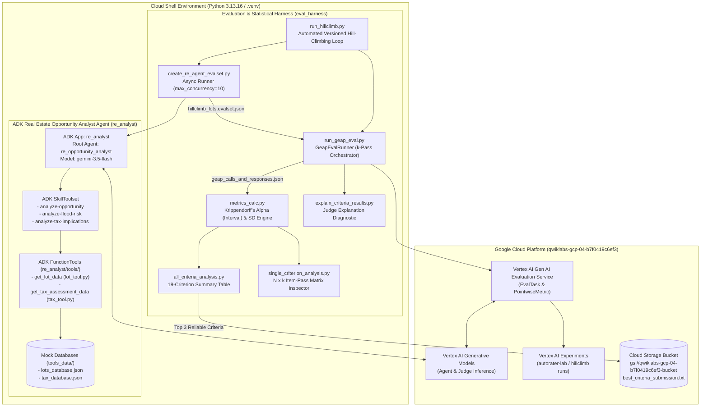

# Architecture, High-Level Design (HLD), Low-Level Design (LLD) & Workflow Specification

## 1. Executive Summary & System Context

Modern Generative AI agents operating in enterprise domains—such as real estate acquisition and land development analysis—must produce complex, multi-faceted analytical reports grounded in structured tool outputs. Evaluating such open-ended outputs at scale requires **LLM-as-a-Judge (Autoraters)**. However, LLM judges are stochastic and sensitive to rubric ambiguity: an uncalibrated rubric can either be too noisy (low intra-rater agreement across passes) or fall prey to the **homogeneity trap** (assigning identical scores to every report, yielding zero discriminative power).

This system implements an end-to-end **Agent Evaluation, Statistical Consistency Analysis, and Iterative Hill-Climbing Pipeline** built on **Google Agent Development Kit (ADK)** and the **Vertex AI Gen AI Evaluation Service (GEAP)**:
1. **Batch Agent Execution (`eval_harness/create_re_agent_evalset.py`)**: Runs the `re_analyst` ADK agent (`re_opportunity_analyst` powered by `gemini-3.5-flash`) concurrently across 10 target land parcels (`LOT-8472`, `LOT-8471`, `LOT-8473`, `LOT-1000`..`LOT-1006`) using `InMemorySessionService` and `Runner`, outputting an ADK 2.0 `EvalSet` JSON trace (`re_analyst/hillclimb_lots.evalset.json`).
2. **Multi-Pass Pointwise Autorating (`eval_harness/run_geap_eval.py`)**: Compiles 19 candidate Likert-scale (1–5) evaluation criteria from `eval_harness/rubrics.json` into `PointwiseMetricPromptTemplate` and `PointwiseMetric` objects and dispatches $k$-pass evaluations to Vertex AI's `EvalTask`.
3. **Inter-/Intra-Rater Statistical Reliability Engine (`eval_harness/metrics_calc.py`, `all_criteria_analysis.py`, `single_criterion_analysis.py`)**: Analyzes multi-pass evaluation matrices ($N = 32$ reports $\times$ $k = 15$ passes across $19$ criteria = $9,120$ ratings) using **Krippendorff's Alpha ($\alpha$, interval)**, **Mean Pairwise Agreement**, **Between-Report Standard Deviation ($\text{SD}_{\text{report\_means}}$)**, and **Between-Pass Standard Deviation ($\text{SD}_{\text{pass\_means}}$)**.
4. **Diagnostic & Iterative Skill Hill-Climbing Loop (`eval_harness/explain_criteria_results.py`, `run_hillclimb.py`)**: Extracts judge rationales on low-scoring criteria (`cost-per-acre` and `neighboring-flood-risk`), guides targeted updates to the agent's modular ADK skills (`re_analyst/skills/*/SKILL.md`), and verifies that the improved agent achieves a perfect **5.0000 / 5.0** mean score across all target lots.

---

## 2. High-Level Design (HLD)

### 2.1 System Architecture Diagram



### 2.2 Architectural Layers & Separation of Concerns

1. **Agent & Skill Layer (`re_analyst/`)**:
   - Decouples **core agent orchestration** (`re_analyst/agent.py`) from **domain investigation procedures** (`re_analyst/skills/*/SKILL.md`) and **data retrieval tools** (`re_analyst/tools/lot_tool.py`, `re_analyst/tools/tax_tool.py`).
   - Uses ADK's `SkillToolset` (`google.adk.tools.skill_toolset.SkillToolset`) so the agent dynamically loads domain instructions (`analyze-opportunity`, `analyze-flood-risk`, `analyze-tax-implications`) at runtime without bloating the static system prompt.
2. **Dataset & Trace Generation Layer (`eval_harness/create_re_agent_evalset.py`)**:
   - Reads a list of target Lot IDs (`eval_harness/hillclimb_lots.txt`), constructs an `EvalCase` per lot, runs `Runner.run_async` with `asyncio.Semaphore(10)` over `InMemorySessionService`, converts session events into ADK 2.0 `EvalInvocation` traces via `EvaluationGenerator.convert_events_to_eval_invocations()`, and serializes a validated Pydantic `EvalSet`.
3. **Cloud Evaluation Adapter Layer (`eval_harness/run_geap_eval.py`)**:
   - Bridges ADK `EvalSet` JSON files and Vertex AI's `EvalTask`.
   - Transforms `eval_harness/rubrics.json` into `PointwiseMetricPromptTemplate` and `PointwiseMetric` instances, executes $k$ stochastic evaluation passes in `us-central1`, and saves both the rendered judge prompt (`prompt_made_to_service`) and the $k$-pass scores/explanations (`responses_from_service`).
4. **Statistical Reliability & Hill-Climbing Layer (`eval_harness/metrics_calc.py`, `all_criteria_analysis.py`, `single_criterion_analysis.py`, `explain_criteria_results.py`, `run_hillclimb.py`)**:
   - Computes inter-/intra-rater reliability metrics across $N \times k$ score matrices, surfaces judge rationales for error analysis, and automates versioned hill-climbing iterations (`runs/hillclimb_1/`, `runs/hillclimb_2/`, ...).

---

## 3. Low-Level Design (LLD)

### 3.1 Codebase Module Specifications

| File Path | Key Classes / Functions | Technical Implementation Details |
| :--- | :--- | :--- |
| `re_analyst/agent.py` | `re_opportunity_analyst` (`Agent`), `app` (`App`), `skill_toolset` (`SkillToolset`) | Loads `MODEL`, `GOOGLE_CLOUD_PROJECT`, and `GOOGLE_CLOUD_LOCATION` from `.env`. Wraps `get_lot_data` and `get_tax_assessment_data` as `FunctionTool`s inside `SkillToolset` alongside the 3 skill directories. Enforces a 5-section Markdown report structure (`Executive Summary`, `Acquisition Basis and Holding Costs`, `Zoning and Infrastructure Readiness`, `Risk Assessment`, `Recommendation`). |
| `re_analyst/tools/lot_tool.py` | `get_lot_data(plot_id: str) -> str`, `_get_lots_db()` | Loads and caches `tools_data/lots_database.json` in memory (`_LOTS_DB_CACHE`). Performs case-insensitive lookup of `plot_id` (e.g., `LOT-8472`) returning JSON with `acreage`, `zoning`, `last_sale_price`, `estimated_annual_taxes`, `flood_zone`, `environmental_status`, `utility_access`, `topography`, `soil_classification`, `easement_type`, `adjacent_parcels`, and `parcel_apn`. |
| `re_analyst/tools/tax_tool.py` | `get_tax_assessment_data(parcel_apn: str) -> str`, `_get_tax_db()` | Loads and caches `tools_data/tax_database.json` in memory (`_TAX_DB_CACHE`). Looks up official county tax records by `parcel_apn` (e.g., `049-382-011-000`), returning `annual_tax_amount`, `assessed_land_value`, `assessed_improvement_value`, `total_assessed_value`, `tax_year`, and `payment_status`. |
| `eval_harness/create_re_agent_evalset.py` | `build_real_estate_evalset(...)`, `main()` | Builds ADK `EvalCase` objects with prompt `"Please evaluate investment suitability for lot {lot_id} and generate a report."` Executes the ADK `App` concurrently (`asyncio.Semaphore(10)`), converts session events into `EvalSet` JSON, and properly closes async HTTP client pools (`client.aio.aclose()`). |
| `eval_harness/run_geap_eval.py` | `GeapEvalRunner` (`_load_traces`, `_load_criteria`, `_build_pointwise_metrics`, `execute_cloud_evaluation`, `assemble_and_save_records`) | Disables mTLS (`GOOGLE_API_USE_MTLS="never"`) to prevent `pyOpenSSL` connection reuse errors during concurrent `EvalTask` runs. Applies an SDK workaround (`template.variables = template._get_variables()`) so `PointwiseMetricPromptTemplate.assemble(response=...)` renders prompts cleanly. |
| `eval_harness/metrics_calc.py` | `krippendorff_alpha_interval(grades_df)`, `compute_percent_agreement_row(row)`, `compute_criterion_stats(grades_df)` | Transposes the $(N, k)$ DataFrame to $(k, N)$ for `krippendorff_alpha(df.T, DataTypeEnum.INTERVAL)`. Computes exact row-wise pairwise agreement $\frac{\sum c_i(c_i - 1)}{n(n-1)}$ and row/column descriptive statistics (`sd_report_means`, `sd_pass_means`, `max_range_report`, `max_range_pass`). |
| `eval_harness/all_criteria_analysis.py` | `analyze_all_criteria(eval_output_path)` | Loads GEAP JSON records via `load_eval_ratings_by_criterion()`, computes `compute_criterion_stats()` for each criterion, and prints a formatted 9-column statistical comparison table. |
| `eval_harness/single_criterion_analysis.py` | `analyze_single_criterion(eval_output_path, criterion_id)` | Renders the full $N \times k$ item-by-pass score matrix (`p1`..`pk`) augmented with per-item `min`, `max`, `range`, `mean`, `sd`, `%_agree`, and bottom summary rows for pass statistics. |
| `eval_harness/explain_criteria_results.py` | `explain_criteria(eval_output_path, criteria_ids)` | Groups evaluation results by criterion and lot (`eval_id`), printing each pass's numeric score and full natural-language judge `explanation`. |
| `eval_harness/run_hillclimb.py` | `get_next_run_dir(runs_dir, base_name)`, `main()` | Automatically creates the next versioned folder (`runs/hillclimb_1`, `runs/hillclimb_2`, ...), generates fresh agent traces (`re_analyst/hillclimb_1.evalset.json`), runs a $k=1$ GEAP evaluation on `["cost-per-acre", "neighboring-flood-risk"]`, saves `runs/hillclimb_X/geap_calls_and_responses_hillclimb_X.json`, and prints mean scores. |

---

### 3.2 Data Schemas

#### 1. Property & Tax Databases (`tools_data/lots_database.json` & `tools_data/tax_database.json`)

```json
// tools_data/lots_database.json (Excerpt for LOT-8472)
{
  "LOT-8472": {
    "plot_id": "LOT-8472",
    "parcel_apn": "049-382-011-000",
    "acreage": 1.2,
    "zoning": "R-3 (Multi-Family Residential)",
    "last_sale_price": "$450,000",
    "estimated_annual_taxes": "$5,400",
    "flood_zone": "Zone AE (High Risk)",
    "environmental_status": "Clear - Phase I ESA Completed 2022",
    "utility_access": "Municipal water and sewer at street frontage",
    "topography": "0-2% grade (Flat)",
    "soil_classification": "Clay loam - Moderate drainage",
    "easement_type": "Drainage Easement (15ft along northern boundary)",
    "adjacent_parcels": ["LOT-8471", "LOT-8473"]
  }
}
```

```json
// tools_data/tax_database.json (Excerpt for APN 049-382-011-000)
{
  "049-382-011-000": {
    "parcel_apn": "049-382-011-000",
    "tax_year": 2024,
    "assessed_land_value": "$380,000",
    "assessed_improvement_value": "$0",
    "total_assessed_value": "$380,000",
    "annual_tax_amount": "$6,840.00",
    "payment_status": "Current"
  }
}
```

#### 2. GEAP Evaluation Record Schema (`runs/*/geap_calls_and_responses*.json`)

```json
[
  {
    "eval_id": "LOT-8472",
    "criterion_id": "cost-per-acre",
    "criterion_name": "Cost-Per-Acre Valuation Calculation",
    "prompt_made_to_service": "...rendered PointwiseMetricPromptTemplate...",
    "responses_from_service": [
      {
        "eval_pass_index": 1,
        "score": 5.0,
        "explanation": "The response explicitly calculates the acquisition cost-per-acre ($450,000 / 1.2 acres = $375,000.00 per acre) and emphasizes it as a core valuation metric..."
      }
    ]
  }
]
```

---

### 3.3 Mathematical Formulation of Autorater Consistency Metrics (`eval_harness/metrics_calc.py`)

Given an evaluation matrix $S \in \{1, 2, 3, 4, 5\}^{N \times k}$ for a single rubric criterion where $N$ is the number of evaluated property reports ($N = 32$) and $k$ is the number of independent evaluation passes ($k = 15$):

1. **Per-Report Mean ($\bar{S}_{i\cdot}$) and Between-Report Standard Deviation ($\text{SD}_{\text{report\_means}}$)**:
   $$\bar{S}_{i\cdot} = \frac{1}{k} \sum_{j=1}^{k} S_{ij}, \qquad \text{SD}_{\text{report\_means}} = \sqrt{\frac{1}{N - 1} \sum_{i=1}^{N} \left(\bar{S}_{i\cdot} - \bar{S}_{\cdot\cdot}\right)^2}$$
   - **Interpretation**: Measures **discriminative signal** (how much the criterion differentiates between high-quality and low-quality reports). If $\text{SD}_{\text{report\_means}} = 0$, the criterion assigns the same score to every report (a **Homogeneity Trap**).

2. **Per-Pass Mean ($\bar{S}_{\cdot j}$) and Between-Pass Standard Deviation ($\text{SD}_{\text{pass\_means}}$)**:
   $$\bar{S}_{\cdot j} = \frac{1}{N} \sum_{i=1}^{N} S_{ij}, \qquad \text{SD}_{\text{pass\_means}} = \sqrt{\frac{1}{k - 1} \sum_{j=1}^{k} \left(\bar{S}_{\cdot j} - \bar{S}_{\cdot\cdot}\right)^2}$$
   - **Interpretation**: Measures global pass-to-pass drift. Note that $\text{SD}_{\text{pass\_means}}$ can be deceptively small even when individual items flip scores in opposite directions across passes (a classic **distractor metric** if used alone).

3. **Mean Pairwise Agreement ($\text{PA}$)**:
   For report $i$ with $n_i$ non-null pass ratings and frequency count $c_{i,v}$ for each unique rating value $v \in \{1..5\}$:
   $$\text{PA}_i = \frac{\sum_{v} c_{i,v}(c_{i,v} - 1)}{n_i(n_i - 1)}, \qquad \text{Mean PA} = \frac{1}{N} \sum_{i=1}^{N} \text{PA}_i$$
   - **Interpretation**: Measures exact pass-to-pass agreement within each report, **uncorrected for chance**. Under severe score homogeneity (e.g., 99% of ratings are `5`), $\text{Mean PA}$ is inflated near `100%` even if the autorater has no real discriminative ability.

4. **Krippendorff's Alpha ($\alpha$, Interval Scale)**:
   $$\alpha = 1 - \frac{D_o}{D_e}$$
   where $D_o$ is the observed disagreement across passes within the same report and $D_e$ is the expected disagreement by chance given the global distribution of ratings across all $N \times k$ cells using interval distance $\delta^2(v, v') = (v - v')^2$.
   - **Decision Rule for Reliable Autoraters**:
     - $\alpha \ge 0.80$: High chance-corrected intra-rater reliability.
     - $\text{SD}_{\text{report\_means}} > 0.30$: Meaningful between-report variance (avoids the homogeneity trap where $\alpha = 1.0$ simply because every single cell in $S$ equals `5`).

---

## 4. End-to-End Operational & Hill-Climbing Workflow

```mermaid
stateDiagram-v2
    [*] --> EnvSetup: "Task 1: GCS Download, Python 3.13 (.venv) & .env"
    EnvSetup --> AgentInspect: "Task 2: Test re_analyst in ADK Web (LOT-8472)"
    AgentInspect --> TraceGen: "Task 3: create_re_agent_evalset.py (10 Hillclimb Lots)"
    TraceGen --> BaselineEval: "Task 4: run_geap_eval.py (k=5 Passes, 19 Criteria)"
    BaselineEval --> ConsistencyStudy: "Task 5: Analyze 15-Pass Dataset (all_criteria_analysis.py)"

    state ConsistencyStudy {
        [*] --> ComputeMetrics: "Compute alpha, Mean PA, SD_report_means"
        ComputeMetrics --> FilterTraps: "Reject Homogeneity Traps (SD_report_means ~ 0) & Noisy Criteria (alpha < 0.80)"
        FilterTraps --> SelectTop3: "Select monthly-tax-holding (0.997), flood-zone-flagging (0.897), environmental-esa (0.897)"
    }

    ConsistencyStudy --> HillClimbLoop: "Task 6: Diagnose & Hill Climb Target Criteria"

    state HillClimbLoop {
        [*] --> DiagnoseFailures: "explain_criteria_results.py (cost-per-acre=1.08, neighboring-flood-risk=1.04)"
        DiagnoseFailures --> RefineSkills: "Update SKILL.md (Exact Cost/Acre Math + Adjacent Parcel Flood Lookup)"
        RefineSkills --> RunHillclimb: "run_hillclimb.py -> runs/hillclimb_1"
        RunHillclimb --> CheckThreshold: "Both Criteria Mean > 4.0?"
        CheckThreshold --> RefineSkills: "No (< 4.0)"
        CheckThreshold --> [*]: "Yes (cost-per-acre = 5.0000, neighboring-flood-risk = 5.0000)"
    }

    HillClimbLoop --> [*]: "Lab Complete (100% Score)"
```



---

## 5. Skill Engineering Architecture (Before vs. After Hill Climbing)

### 5.1 Root Cause Diagnosis of Baseline Failures

When evaluating the initial `re_analyst` baseline outputs on the 10 hillclimb lots (`LOT-8472`, `LOT-8471`, `LOT-8473`, `LOT-1000`..`LOT-1006`):

| Target Criterion | Baseline Mean ($k=5$) | Root Cause in Baseline `SKILL.md` Files | Judge Rationale (`explain_criteria_results.py`) |
| :--- | :---: | :--- | :--- |
| **`cost-per-acre`** | **`1.0800`** | `analyze-opportunity/SKILL.md` only told the agent to "note the `last_sale_price` and `acreage`", never instructing it to divide `last_sale_price / acreage` or frame **Acquisition Cost-Per-Acre** as a core valuation benchmark. | *"The response states the total acreage and last sale price, but completely fails to calculate or state the cost-per-acre figure."* (Score `1.0`–`2.0`) |
| **`neighboring-flood-risk`** | **`1.0400`** | `analyze-flood-risk/SKILL.md` only checked the subject lot's `flood_zone`, ignoring the `adjacent_parcels` array in `lots_database.json` and never calling `get_lot_data` on neighboring parcel IDs. | *"The report mentions the subject parcel's flood zone but omits any lookup or flood risk analysis of neighboring/adjacent properties."* (Score `1.0`–`2.0`) |

### 5.2 Structural Skill Enhancements Applied

1. **`re_analyst/skills/analyze-opportunity/SKILL.md`**:
   - Added **Mandatory Acquisition Cost-Per-Acre Calculation & Valuation Benchmarking** ($\text{Last Sale Price} / \text{Acreage}$), requiring explicit step-by-step arithmetic in both the `Executive Summary` and `Acquisition Basis and Holding Costs` sections, plus benchmarking against **Assessed Land Value Per Acre** ($\text{Assessed Land Value} / \text{Acreage}$).
   - Directed the agent to look up **every** parcel ID listed in `adjacent_parcels` via `get_lot_data` and synthesize a comprehensive Markdown summary table.
2. **`re_analyst/skills/analyze-flood-risk/SKILL.md`**:
   - Added **Mandatory Lookup of All Neighboring / Adjacent Properties** by iterating over `adjacent_parcels` and calling `get_lot_data` for each neighboring Lot ID.
   - Added **Exhaustive Neighboring Property Hydrological, Drainage & Runoff Analysis**, requiring a dedicated subsection analyzing **Floodplain Continuity & Encroachment**, **Topographic Gradient & Stormwater Runoff Vectors**, **Drainage Easements & Shared Infrastructure**, and **Development Feasibility Impact**.
3. **`re_analyst/skills/analyze-tax-implications/SKILL.md`**:
   - Added explicit derivations for **Acquisition Cost-Per-Acre**, **Assessed Land Value Per Acre**, and **Monthly Tax Holding Cost** ($\text{Annual Tax Amount} / 12$).
