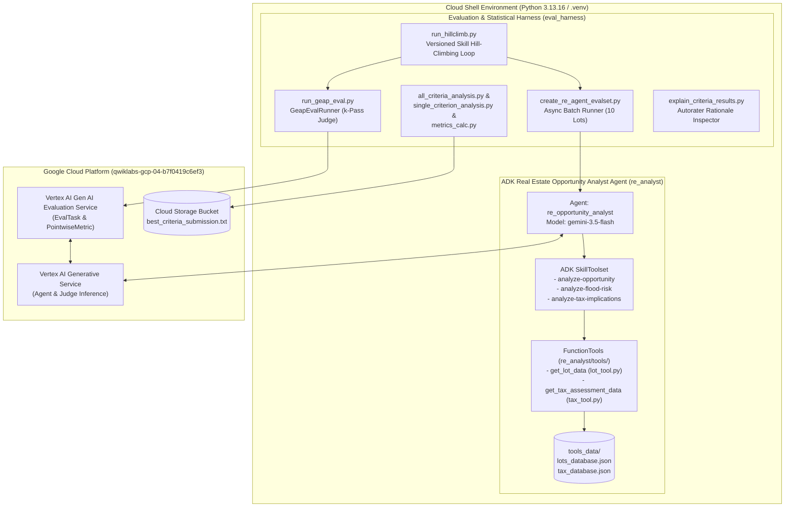

# Evaluating and Hill Climbing a Generative AI Agent Using Autoraters — Architecture, HLD/LLD & Operational Runbook

[](https://cloud.google.com/vertex-ai/generative-ai/docs/models/evaluation-overview)
[](https://google.github.io/adk-docs/)
[](https://www.python.org/)
[](#hill-climbing-results-summary)

Complete architectural documentation, High-Level Design (HLD), Low-Level Design (LLD), statistical reliability analysis, step-by-step operational runbook, and Antigravity (AGY) execution history for the Google Cloud Challenge Lab **"Evaluating and Hill Climbing a Generative AI Agent Using Autoraters"**.

---

## Documentation Index

| Document | Description |
| :--- | :--- |
| **[`ARCHITECTURE_AND_DESIGN.md`](./ARCHITECTURE_AND_DESIGN.md)** | **High-Level Design (HLD) & Low-Level Design (LLD)**: System context, multi-pass LLM-as-a-Judge architecture, data schemas (`EvalSet`, GEAP JSON), statistical reliability mathematics (Krippendorff's $\alpha$, pairwise agreement, homogeneity traps), and skill engineering architecture. |
| **[`RUNBOOK.md`](./RUNBOOK.md)** | **Step-by-Step Operational Runbook**: Exact CLI commands, verified terminal outputs, full 19-criterion statistical consistency table, single-criterion matrices, baseline vs. hillclimb judge rationales, and exact `SKILL.md` updates for Tasks 1–6. |
| **[`TASK5_CRITERIA_SELECTION_METHODOLOGY.md`](./TASK5_CRITERIA_SELECTION_METHODOLOGY.md)** | **Task 5 Statistical Calculation & Criteria Selection Deep-Dive**: Step-by-step mathematical formulas (`metrics_calc.py`), 5-stage elimination funnel ($4 + 2 + 8 + 2 + 3 = 19$), worked pairwise/$\alpha$ calculations, and $N=32 \times k=15$ matrix case studies explaining how `monthly-tax-holding`, `flood-zone-flagging`, and `environmental-esa` were selected. |
| **[`AGY_SESSION_HISTORY.md`](./AGY_SESSION_HISTORY.md)** | **Antigravity (AGY) & Cloud Shell Session Log**: Chronological execution timeline, tool calls, `uv` Python 3.13.16 optimization, and troubleshooting log. |

---

## System Architecture Overview



---

## Key Results Summary

### 1. Autorater Self-Consistency Study (Task 5 — 19 Criteria, $N=32$ Reports, $k=15$ Passes)

By combining **Intra-Rater Reliability** ($\text{Krippendorff's }\alpha > 0.80$, high pairwise agreement, low $\text{SD}_{\text{pass\_means}}$) with **Inter-Report Discriminative Power** ($\text{SD}_{\text{report\_means}} > 0.30$), we filtered out 4 homogeneity traps (`general-tone`, `logical-flow`, `professionalism`, `readability`), 2 near-homogeneity traps (`data-density`, `professional-tone`), and 8 noisy criteria ($\alpha < 0.80$) to select the **3 additional reliable criteria**:

| Selected Criterion | Mean Score | Min / Max | $\text{SD}_{\text{report\_means}}$ | $\text{SD}_{\text{pass\_means}}$ | Pairwise Agreement | Krippendorff's $\alpha$ |
| :--- | :---: | :---: | :---: | :---: | :---: | :---: |
| **`monthly-tax-holding`** | `2.2764` | `2` / `5` | `0.8872` | `0.0228` | `99.17%` | **`0.997`** |
| **`flood-zone-flagging`** | `4.8447` | `3` / `5` | `0.3357` | `0.0256` | `94.41%` | **`0.897`** |
| **`environmental-esa`** | `4.2772` | `2` / `5` | `0.7042` | `0.0991` | `79.10%` | **`0.897`** |

Submitted to `gs://qwiklabs-gcp-04-b7f0419c6ef3-bucket/best_criteria_submission.txt`:
```text
monthly-tax-holding,flood-zone-flagging,environmental-esa
```

---

### 2. Hill Climbing Results Summary (Task 6 — `LOT-8472` to `LOT-1006`)

After diagnosing the baseline judge rationales via `explain_criteria_results.py` and refining `analyze-opportunity/SKILL.md`, `analyze-flood-risk/SKILL.md`, and `analyze-tax-implications/SKILL.md`:

| Target Criterion | Baseline Mean ($k=5$) | Target Threshold | Hillclimb Iteration 1 Mean | Status |
| :--- | :---: | :---: | :---: | :---: |
| **`cost-per-acre`** | `1.0800` | `> 4.0` | **`5.0000`** (`Min: 5.0, Max: 5.0`) | **PASSED (+3.9200)** |
| **`neighboring-flood-risk`** | `1.0400` | `> 4.0` | **`5.0000`** (`Min: 5.0, Max: 5.0`) | **PASSED (+3.9600)** |

---

## Repository Structure

```text
autoraters/
├── README.md                                   # Project overview, architecture & results summary
├── ARCHITECTURE_AND_DESIGN.md                  # Deep-dive HLD, LLD, schemas & statistical formulas
├── RUNBOOK.md                                  # Step-by-step operational runbook (Tasks 1-6)
├── TASK5_CRITERIA_SELECTION_METHODOLOGY.md     # Detailed statistical guide for Task 5 criteria selection
├── AGY_SESSION_HISTORY.md                      # Chronological AGY & Cloud Shell execution log
├── best_criteria_submission.txt        # Task 5 submission file
├── requirements.txt                    # Python 3.13 dependencies
├── .env.example                        # Example environment configuration
├── eval_harness/                       # Evaluation & statistical analysis harness
│   ├── __init__.py
│   ├── all_criteria_analysis.py
│   ├── create_re_agent_evalset.py
│   ├── explain_criteria_results.py
│   ├── hillclimb_lots.txt
│   ├── metrics_calc.py
│   ├── rubrics.json
│   ├── run_geap_eval.py
│   ├── run_hillclimb.py
│   ├── single_criterion_analysis.py
│   └── utils.py
├── re_analyst/                         # ADK Real Estate Opportunity Analyst Agent
│   ├── __init__.py
│   ├── agent.py
│   ├── hillclimb_lots.evalset.json
│   ├── hillclimb_1.evalset.json
│   ├── skills/
│   │   ├── analyze-opportunity/SKILL.md
│   │   ├── analyze-flood-risk/SKILL.md
│   │   └── analyze-tax-implications/SKILL.md
│   └── tools/
│       ├── __init__.py
│       ├── lot_tool.py
│       └── tax_tool.py
├── tools_data/                         # Property & county tax assessment datasets
│   ├── lots_database.json
│   └── tax_database.json
└── runs/                               # Evaluation outputs (baseline, 15-pass analysis, hillclimb_1)
    ├── baseline/geap_calls_and_responses.json
    ├── geap_calls_and_responses_for_analysis.json
    └── hillclimb_1/geap_calls_and_responses_hillclimb_1.json
```
