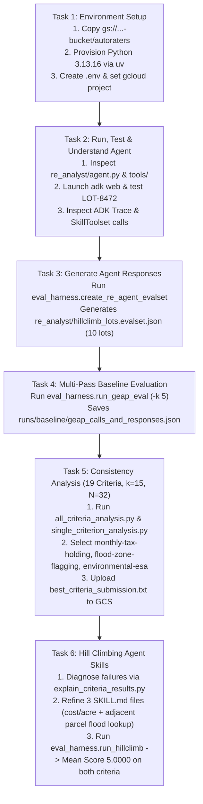

# Step-by-Step Operational Runbook: Evaluating and Hill Climbing a Generative AI Agent Using Autoraters

This runbook provides the complete end-to-end execution guide, exact CLI commands, verified terminal outputs, statistical consistency tables, autorater rationales, and skill modifications for the Google Cloud Challenge Lab **"Evaluating and Hill Climbing a Generative AI Agent Using Autoraters"**.

---

## Lab Environment Summary

| Parameter | Value |
| :--- | :--- |
| **GCP Project ID** | `qwiklabs-gcp-04-b7f0419c6ef3` |
| **GCS Lab Bucket** | `gs://qwiklabs-gcp-04-b7f0419c6ef3-bucket` |
| **Vertex AI Location** | `global` (Agent `.env` endpoint) / `us-central1` (Vertex AI Evaluation Service & Experiments) |
| **Agent Model** | `gemini-3.5-flash` (configured via `.env` `MODEL=gemini-3.5-flash`) |
| **Working Directory** | `/home/student_04_abad9f02386c/autoraters` |
| **Python Runtime** | Python `3.13.16` (provisioned via `uv` in `/home/student_04_abad9f02386c/autoraters/.venv`) |

---

## End-to-End Execution Workflow



---

## Task 1: Set Up Your Environment

### Step 1.1: Verify GCP Authentication and Set Active Project

```bash
gcloud auth list
gcloud config set project qwiklabs-gcp-04-b7f0419c6ef3
```

**Verified Output:**
```text
Credentialed Accounts
ACTIVE  ACCOUNT
*       student-04-abad9f02386c@qwiklabs.net
Updated property [core/project].
```

### Step 1.2: Download Lab Codebase from Cloud Storage

```bash
cd ~
gcloud storage cp -r gs://qwiklabs-gcp-04-b7f0419c6ef3-bucket/autoraters .
```

**Verified Output:**
```text
Copying gs://qwiklabs-gcp-04-b7f0419c6ef3-bucket/autoraters/eval_harness/all_criteria_analysis.py...
...
Completed files 26/26 | 3.4MiB/3.4MiB
```

### Step 1.3: Provision Python 3.13 and Install Lab Requirements

> **Speed Optimization Note:** `krippendorff-aleph-alpha==0.1.17` requires `Python >= 3.13`. Using `uv` downloads a prebuilt `CPython 3.13.16` binary and installs all 162 packages in ~2 seconds (compared to 5–10 minutes when compiling Python 3.13 from source via `pyenv`).

```bash
cd ~/autoraters
uv venv --python 3.13 --seed .venv
source .venv/bin/activate
uv pip install -r requirements.txt
python3 --version
```

**Verified Output:**
```text
Using CPython 3.13.16
Creating virtual environment with seed packages at: .venv
Installed 162 packages in 726ms
Python 3.13.16
```

### Step 1.4: Create the `.env` File in `~/autoraters`

```bash
cd ~/autoraters
cat << 'EOF' > .env
GOOGLE_GENAI_USE_VERTEXAI=TRUE
GOOGLE_CLOUD_PROJECT=qwiklabs-gcp-04-b7f0419c6ef3
GOOGLE_CLOUD_LOCATION=global
MODEL=gemini-3.5-flash
EOF
```

---

## Task 2: Run, Test, and Understand the Agent

### Step 2.1: Inspect the Agent and Tool Definitions

- **Agent Definition (`re_analyst/agent.py`)**:
  - Defines `re_opportunity_analyst` (`google.adk.agents.Agent`) wrapped in `app = App(name="re_analyst", root_agent=re_opportunity_analyst)`.
  - Equips the agent with `SkillToolset` containing 3 skills (`analyze-opportunity`, `analyze-flood-risk`, `analyze-tax-implications`) and 2 `FunctionTool`s (`get_lot_data`, `get_tax_assessment_data`).
- **Tools (`re_analyst/tools/lot_tool.py` & `re_analyst/tools/tax_tool.py`)**:
  - `get_lot_data(plot_id)` queries `tools_data/lots_database.json`.
  - `get_tax_assessment_data(parcel_apn)` queries `tools_data/tax_database.json`.

### Step 2.2: Start ADK Web UI (Interactive Testing)

```bash
cd ~/autoraters
source .venv/bin/activate
adk web --allow_origins "regex:https://.*\.cloudshell\.dev"
```

When prompted with `"Please evaluate investment suitability for lot LOT-8472 and generate a report."`, the baseline agent loads `analyze-opportunity`, calls `get_lot_data(plot_id="LOT-8472")` and `get_tax_assessment_data(parcel_apn="049-382-011-000")`, and drafts a 5-section Initial Site Evaluation Memorandum.

---

## Task 3: Generate Agent Responses for Evaluation

### Step 3.1: Inspect the Target Hillclimb Lots (`eval_harness/hillclimb_lots.txt`)

`eval_harness/hillclimb_lots.txt` contains 10 target Lot IDs:
```text
LOT-8472
LOT-8471
LOT-8473
LOT-1000
LOT-1001
LOT-1002
LOT-1003
LOT-1004
LOT-1005
LOT-1006
```

### Step 3.2: Run `eval_harness.create_re_agent_evalset`

Execute `create_re_agent_evalset.py` to run `re_analyst` concurrently across all 10 properties and save the populated ADK `EvalSet` JSON to `re_analyst/hillclimb_lots.evalset.json`:

```bash
cd ~/autoraters
source .venv/bin/activate
python3 -m eval_harness.create_re_agent_evalset \
  --lots-file eval_harness/hillclimb_lots.txt \
  --out re_analyst/hillclimb_lots.evalset.json \
  --agent-dir ./re_analyst
```

**Verified Output:**
```text
🚀 Executing 're_analyst' over 10 properties to populate evaluation traces...
-----------------------------------------------------------------
⚡ Starting concurrent execution across 10 properties (max concurrency: 10)...
✅ [1/10] Completed trace for LOT-8472
✅ [2/10] Completed trace for LOT-8471
✅ [3/10] Completed trace for LOT-8473
✅ [4/10] Completed trace for LOT-1000
✅ [5/10] Completed trace for LOT-1001
✅ [6/10] Completed trace for LOT-1002
✅ [7/10] Completed trace for LOT-1003
✅ [8/10] Completed trace for LOT-1004
✅ [9/10] Completed trace for LOT-1005
✅ [10/10] Completed trace for LOT-1006

Cleaning up resources...
✅ Successfully generated real estate evaluation dataset for 10 properties -> re_analyst/hillclimb_lots.evalset.json
```

---

## Task 4: Evaluate Agent Responses with the Gen AI Evaluation Service

### Step 4.1: Run Multi-Pass Cloud Evaluation (`eval_harness.run_geap_eval`)

Execute `run_geap_eval.py` over `re_analyst/hillclimb_lots.evalset.json` with `-k 5` passes across all 19 criteria defined in `eval_harness/rubrics.json`:

```bash
cd ~/autoraters
source .venv/bin/activate
python3 -m eval_harness.run_geap_eval \
  --traces re_analyst/hillclimb_lots.evalset.json \
  --out runs/baseline/geap_calls_and_responses.json \
  -k 5
```

**Verified Output:**
```text
🧪 Vertex AI Experiment Name: autorater-lab-20261029-102616
  ☁️ Dispatching EvalTask pass 1/5 to Vertex AI...
  ☁️ Dispatching EvalTask pass 2/5 to Vertex AI...
  ☁️ Dispatching EvalTask pass 3/5 to Vertex AI...
  ☁️ Dispatching EvalTask pass 4/5 to Vertex AI...
  ☁️ Dispatching EvalTask pass 5/5 to Vertex AI...

✅ Successfully generated GEAP call collection file -> /home/student_04_abad9f02386c/autoraters/runs/baseline/geap_calls_and_responses.json
📊 Total records generated: 190 (10 responses × 19 criteria, 5 passes each)
```

---

## Task 5: Analyze Autorater Self-Consistency and Select Reliable Criteria

In Task 5, you analyze the 15-pass evaluation dataset (`runs/geap_calls_and_responses_for_analysis.json`, containing $N = 32$ property reports $\times$ $k = 15$ passes across $19$ candidate criteria = $9,120$ total ratings) to identify the **3 additional reliable criteria** (alongside `cost-per-acre` and `neighboring-flood-risk`, which were pre-selected for Task 6).

### Step 5.1: Run `all_criteria_analysis.py` on the 15-Pass Dataset

```bash
cd ~/autoraters
source .venv/bin/activate
python3 -m eval_harness.all_criteria_analysis runs/geap_calls_and_responses_for_analysis.json
```

**Verified Output (All 19 Candidate Criteria Across $N=32$ Reports, $k=15$ Passes):**

| Criterion | `mean` | `min` | `max` | `max_range_report` | `max_range_pass` | `sd_report_means` | `sd_pass_means` | `mean_pairwise_agreement` | `krippendorffs_alpha` | Diagnostic Classification |
| :--- | :---: | :---: | :---: | :---: | :---: | :---: | :---: | :---: | :---: | :--- |
| `analyst-insight` | 4.7294 | 4 | 5 | 1 | 1 | 0.2570 | 0.0576 | 71.59% | 0.639 | Unreliable (Low $\alpha < 0.80$) |
| `core-specifications` | 4.3623 | 4 | 5 | 1 | 1 | 0.2648 | 0.0765 | 65.05% | 0.621 | Unreliable (Low $\alpha < 0.80$) |
| `cost-per-acre` | 1.3771 | 1 | 3 | 2 | 2 | 0.2163 | 0.0511 | 58.97% | 0.565 | Pre-selected for Task 6 Hillclimb |
| `data-density` | 4.9979 | 4 | 5 | 1 | 1 | 0.0118 | 0.0081 | 99.58% | 0.499 | Near-Homogeneity Trap ($\text{SD}_{\text{report}} = 0.0118$) |
| `document-formatting` | 4.8361 | 4 | 5 | 1 | 1 | 0.1488 | 0.0487 | 75.22% | 0.548 | Unreliable (Low $\alpha < 0.80$) |
| **`environmental-esa`** | **4.2772** | **2** | **5** | **3** | **3** | **0.7042** | **0.0991** | **79.10%** | **0.897** | **SELECTED (High $\alpha = 0.897$, High $\text{SD}_{\text{report}} = 0.7042$)** |
| **`flood-zone-flagging`** | **4.8447** | **3** | **5** | **1** | **2** | **0.3357** | **0.0256** | **94.41%** | **0.897** | **SELECTED (High $\alpha = 0.897$, High Pairwise $94.41\%$)** |
| `general-tone` | 5.0000 | 5 | 5 | 0 | 0 | 0.0000 | 0.0000 | 100.00% | 1.000 | Homogeneity Trap (Zero Variance across reports) |
| `logical-flow` | 5.0000 | 5 | 5 | 0 | 0 | 0.0000 | 0.0000 | 100.00% | 1.000 | Homogeneity Trap (Zero Variance across reports) |
| **`monthly-tax-holding`** | **2.2764** | **2** | **5** | **1** | **3** | **0.8872** | **0.0228** | **99.17%** | **0.997** | **SELECTED (Highest $\alpha = 0.997$, Highest $\text{SD}_{\text{report}} = 0.8872$)** |
| `neighboring-flood-risk` | 1.0316 | 1 | 2 | 0 | 1 | 0.1768 | 0.0009 | 100.00% | 1.000 | Pre-selected for Task 6 Hillclimb |
| `persuasiveness` | 4.8840 | 4 | 5 | 1 | 1 | 0.2022 | 0.0395 | 86.51% | 0.672 | Unreliable (Low $\alpha < 0.80$) |
| `professional-tone` | 4.9958 | 4 | 5 | 1 | 1 | 0.0164 | 0.0110 | 99.17% | 0.498 | Near-Homogeneity Trap ($\text{SD}_{\text{report}} = 0.0164$) |
| `professionalism` | 5.0000 | 5 | 5 | 0 | 0 | 0.0000 | 0.0000 | 100.00% | 1.000 | Homogeneity Trap (Zero Variance across reports) |
| `readability` | 5.0000 | 5 | 5 | 0 | 0 | 0.0000 | 0.0000 | 100.00% | 1.000 | Homogeneity Trap (Zero Variance across reports) |
| `report-length` | 4.7622 | 4 | 5 | 1 | 1 | 0.1715 | 0.0721 | 67.20% | 0.549 | Unreliable (Low $\alpha < 0.80$) |
| `risk-assessment` | 4.9532 | 3 | 5 | 2 | 2 | 0.1843 | 0.0306 | 96.25% | 0.803 | Rejected (30/32 reports score 5; low discrimination) |
| `utility-topography` | 4.7756 | 4 | 5 | 1 | 1 | 0.3081 | 0.0695 | 82.57% | 0.751 | Rejected ($\alpha = 0.751 < 0.80$) |
| `vocabulary-choice` | 4.9349 | 4 | 5 | 1 | 1 | 0.1365 | 0.0391 | 90.83% | 0.623 | Unreliable (Low $\alpha = 0.623$) |

### Step 5.2: Inspect Individual Criteria Matrices (`single_criterion_analysis.py`)

```bash
python3 -m eval_harness.single_criterion_analysis runs/geap_calls_and_responses_for_analysis.json monthly-tax-holding
python3 -m eval_harness.single_criterion_analysis runs/geap_calls_and_responses_for_analysis.json flood-zone-flagging
python3 -m eval_harness.single_criterion_analysis runs/geap_calls_and_responses_for_analysis.json environmental-esa
python3 -m eval_harness.single_criterion_analysis runs/geap_calls_and_responses_for_analysis.json risk-assessment
```

**Why `monthly-tax-holding`, `flood-zone-flagging`, and `environmental-esa` Are Selected:**
1. **`monthly-tax-holding` ($\alpha = 0.997$, $\text{SD}_{\text{report\_means}} = 0.8872$, Pairwise $= 99.17\%$)**:
   - Near-perfect pass-to-pass stability across all 15 passes while strongly differentiating reports that compute monthly tax holding costs (`5`) from those that only state annual taxes (`2`).
2. **`flood-zone-flagging` ($\alpha = 0.897$, $\text{SD}_{\text{report\_means}} = 0.3357$, Pairwise $= 94.41\%$)**:
   - High reliability (`max_range_report = 1`) and meaningful between-report variance (`min = 3`, `max = 5`).
3. **`environmental-esa` ($\alpha = 0.897$, $\text{SD}_{\text{report\_means}} = 0.7042$, Pairwise $= 79.10\%$)**:
   - High Krippendorff's $\alpha = 0.897$ and the second-highest between-report standard deviation (`0.7042`, `min = 2`, `max = 5`), proving strong discrimination across lots.

### Step 5.3: Save Selected Criteria and Upload to Cloud Storage

```bash
cd ~/autoraters
echo -n "monthly-tax-holding,flood-zone-flagging,environmental-esa" > best_criteria_submission.txt
gcloud storage cp best_criteria_submission.txt gs://qwiklabs-gcp-04-b7f0419c6ef3-bucket/best_criteria_submission.txt
```

**Verified Output:**
```text
Copying file://best_criteria_submission.txt to gs://qwiklabs-gcp-04-b7f0419c6ef3-bucket/best_criteria_submission.txt
Completed files 1/1 | 58.0B/58.0B
```

---

## Task 6: Hill Climb the Agent Skills to Pass the Autoraters

### Step 6.1: Diagnose Baseline Failures Using `explain_criteria_results.py`

Inspect the baseline judge scores and explanations for `cost-per-acre` and `neighboring-flood-risk`:

```bash
cd ~/autoraters
source .venv/bin/activate
python3 -m eval_harness.explain_criteria_results \
  runs/baseline/geap_calls_and_responses.json \
  cost-per-acre neighboring-flood-risk
```

**Baseline Failure Diagnosis (`runs/baseline/geap_calls_and_responses.json`):**
1. **`cost-per-acre` (Baseline Mean: `1.0800`)**:
   - *Rubric Requirement for Score 5*: The report must explicitly derive the exact **Acquisition Cost-Per-Acre** (`Last Sale Price / Acreage`) AND emphasize/benchmark it as a **core valuation metric**.
   - *Baseline Deficit*: The baseline agent stated `last_sale_price` and `acreage` separately without dividing them or benchmarking cost-per-acre.
2. **`neighboring-flood-risk` (Baseline Mean: `1.0400`)**:
   - *Rubric Requirement for Score 5*: The report must explicitly look up all `adjacent_parcels` via `get_lot_data`, state each neighboring parcel's exact FEMA flood zone, and thoroughly analyze shared hydrological, cross-parcel drainage, and runoff risks.
   - *Baseline Deficit*: The baseline agent only checked the subject lot's `flood_zone` and never called `get_lot_data` on the Lot IDs in `adjacent_parcels`.

### Step 6.2: Refine the 3 Agent Skills (`re_analyst/skills/*/SKILL.md`)

1. **Updated `re_analyst/skills/analyze-opportunity/SKILL.md`**:
   - Added mandatory step to derive **Acquisition Cost-Per-Acre** ($\text{Last Sale Price} / \text{Acreage}$) with explicit formula and step-by-step arithmetic in both the `Executive Summary` and `Acquisition Basis and Holding Costs` sections, benchmarking against **Assessed Land Value Per Acre** ($\text{Assessed Land Value} / \text{Acreage}$).
   - Directed the agent to look up every parcel ID in `adjacent_parcels` using `get_lot_data` and synthesize a Markdown summary table.
2. **Updated `re_analyst/skills/analyze-flood-risk/SKILL.md`**:
   - Instructed the agent to iterate over every Lot ID in `adjacent_parcels` and call `get_lot_data` to retrieve each neighbor's `flood_zone`, `topography`, `soil_classification`, and `easement_type`.
   - Added a dedicated subsection **Neighboring Property Flood Risk & Shared Hydrological Analysis** covering **Floodplain Continuity & Encroachment**, **Topographic Gradient & Stormwater Runoff Vectors**, **Drainage Easements & Shared Infrastructure**, and **Development Feasibility Impact**.
3. **Updated `re_analyst/skills/analyze-tax-implications/SKILL.md`**:
   - Added explicit formulas and analysis for **Acquisition Cost-Per-Acre**, **Assessed Land Value Per Acre**, and **Monthly Tax Holding Cost** ($\text{Annual Tax Amount} / 12$).

### Step 6.3: Execute the Hill-Climbing Harness (`eval_harness.run_hillclimb`)

```bash
cd ~/autoraters
source .venv/bin/activate
python3 -m eval_harness.run_hillclimb
```

**Verified Output:**
```text
📂 Created versioned run directory: /home/student_04_abad9f02386c/autoraters/runs/hillclimb_1

🤖 Running agent 're_analyst' over target lots to generate traces...
🚀 Executing 're_analyst' over 10 properties to populate evaluation traces...
-----------------------------------------------------------------
⚡ Starting concurrent execution across 10 properties (max concurrency: 10)...
✅ [1/10] Completed trace for LOT-8472
...
✅ [10/10] Completed trace for LOT-1006

☁️ Dispatching single-pass (k=1) evaluation for criteria: ['cost-per-acre', 'neighboring-flood-risk']...
🧪 Vertex AI Experiment Name: hillclimb-20261029-103609
  ☁️ Dispatching EvalTask pass 1/1 to Vertex AI...
✅ Evaluation results saved to -> /home/student_04_abad9f02386c/autoraters/runs/hillclimb_1/geap_calls_and_responses_hillclimb_1.json

=========================================
📊 Hill Climbing Results: hillclimb_1
=========================================
 • cost-per-acre             Mean Score: 5.0000
 • neighboring-flood-risk    Mean Score: 5.0000
=========================================
```

### Step 6.4: Verify Post-Hillclimb Judge Rationales

```bash
python3 -m eval_harness.explain_criteria_results \
  runs/hillclimb_1/geap_calls_and_responses_hillclimb_1.json \
  cost-per-acre neighboring-flood-risk
```

| Criterion | Baseline Mean ($k=5$) | Hillclimb 1 Mean ($k=1$) | Target Threshold | Result |
| :--- | :---: | :---: | :---: | :---: |
| **`cost-per-acre`** | `1.0800` | **`5.0000`** (`10/10` lots scored `5.0`) | `> 4.0` | **PASSED (+3.9200)** |
| **`neighboring-flood-risk`** | `1.0400` | **`5.0000`** (`10/10` lots scored `5.0`) | `> 4.0` | **PASSED (+3.9600)** |
