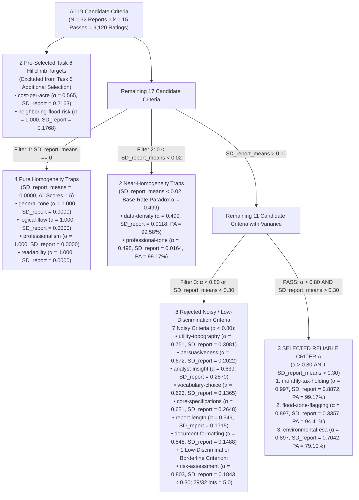

# Task 5 Deep-Dive Guide: Statistical Logic & Calculation Methodology for Selecting the 3 Reliable Autorater Criteria

This document provides the complete mathematical formulation, step-by-step calculation logic, rubric design analysis, and elimination funnel used in **Task 5 (Autorater Self-Consistency Study — 19 Criteria, $N=32$ Reports, $k=15$ Passes)** to select the **3 additional reliable evaluation criteria**:

```text
monthly-tax-holding,flood-zone-flagging,environmental-esa
```

---

## 1. Executive Summary: The Two-Axis Selection Decision Rule

When evaluating Generative AI agents with **LLM-as-a-Judge (Autoraters)**, a rubric criterion is only useful for hill climbing if it satisfies **two orthogonal statistical properties simultaneously** across a multi-pass evaluation matrix $S \in \{1, 2, 3, 4, 5\}^{N \times k}$ ($N = 32$ property reports $\times$ $k = 15$ independent evaluation passes = $480$ ratings per criterion):

1. **Axis 1 — High Intra-Rater Reliability (Self-Consistency Across Passes)**:
   - **Primary Metric**: **Krippendorff's Alpha ($\alpha > 0.80$, interval scale)**
   - **Supporting Metrics**: High **Mean Pairwise Percent Agreement** ($\text{Mean PA}$) and low **Between-Pass Standard Deviation** ($\text{SD}_{\text{pass\_means}} < 0.10$).
   - **Meaning**: When the LLM judge grades the *exact same report* 15 separate times, it must assign the same score (or nearly the same score) on every pass. If $\alpha < 0.80$, the rubric wording is too subjective or ambiguous, causing stochastic pass-to-pass flipping.

2. **Axis 2 — High Inter-Report Discriminative Power (Signal Across Reports)**:
   - **Primary Metric**: **Standard Deviation of Report Means ($\text{SD}_{\text{report\_means}} > 0.30$)**
   - **Supporting Metrics**: Wide **Max Range Pass** ($\text{max\_range\_pass} \ge 2$, showing the judge actually uses different points on the 1–5 Likert scale across different reports).
   - **Meaning**: The criterion must meaningfully differentiate strong property reports from weak property reports. If the judge assigns `5` to every single report ($\text{SD}_{\text{report\_means}} = 0.0000$), the criterion has **zero variance** and provides **zero gradient signal** for hill climbing—even though its raw agreement is `100%` and $\alpha = 1.000$.

### Complete 19-Criteria Partitioning Funnel ($4 + 2 + 8 + 2 + 3 = 19$)



> [!NOTE]
> **How the Counts Add Up across All 19 Criteria:**
> - **8 criteria have $\alpha < 0.80$** (excluding the 2 near-homogeneity traps): `analyst-insight` ($0.639$), `core-specifications` ($0.621$), `cost-per-acre` ($0.565$, pre-selected for Task 6), `document-formatting` ($0.548$), `persuasiveness` ($0.672$), `report-length` ($0.549$), `utility-topography` ($0.751$), and `vocabulary-choice` ($0.623$).
> - **4 criteria are Pure Homogeneity Traps** ($\text{SD}_{\text{report\_means}} = 0.0000$): `general-tone`, `logical-flow`, `professionalism`, `readability`.
> - **2 criteria are Near-Homogeneity Traps** ($\text{SD}_{\text{report\_means}} < 0.02$): `data-density` ($0.0118$), `professional-tone` ($0.0164$).
> - **2 criteria have $\alpha \ge 0.80$ but Low Inter-Report Variance ($\text{SD}_{\text{report\_means}} < 0.30$)**: `neighboring-flood-risk` ($\text{SD}_{\text{report}} = 0.1768$, pre-selected for Task 6) and `risk-assessment` ($\text{SD}_{\text{report}} = 0.1843$, where 29 of 32 reports score a flat `5.0`).
> - **3 criteria pass both thresholds ($\alpha > 0.80$ and $\text{SD}_{\text{report\_means}} > 0.30$)**: `monthly-tax-holding`, `flood-zone-flagging`, and `environmental-esa`.

---

## 2. Step-by-Step Mathematical Basis & Code Implementation (`eval_harness/metrics_calc.py`)

### 2.1 Constructing the $N \times k$ Grades Matrix ($S$)

For each criterion $c \in \{1..19\}$, `eval_harness/utils.py` (`build_grades_dataframe`) pivots the flat GEAP evaluation records from `runs/geap_calls_and_responses_for_analysis.json` into a 2D Pandas DataFrame `grades_df` of shape $(N, k) = (32, 15)$:
- **Rows ($i \in \{1..32\}$)**: Unique property evaluation reports (`LOT-1000`, `LOT-1002`, ..., `LOT-1058`, `LOT-8471`, `LOT-8473`).
- **Columns ($j \in \{1..15\}$)**: Independent evaluation passes (`p1`, `p2`, ..., `p15`).
- **Cells ($S_{ij} \in \{1, 2, 3, 4, 5\} \cup \{\text{NaN}\}$)**: The integer Likert score assigned to report $i$ on pass $j$.

---

### 2.2 Row-Wise (Per-Report) vs. Column-Wise (Per-Pass) Statistics

In `eval_harness/metrics_calc.py` (`compute_criterion_stats`, lines 88–118), statistics are computed along two axes:

#### 1. Per-Report Mean ($\bar{S}_{i\cdot}$) and StdDev of Report Means ($\text{SD}_{\text{report\_means}}$) — **Signal Metric**
First, for each property report $i \in \{1..N\}$, we average its scores across all $k_i$ valid passes:
$$\bar{S}_{i\cdot} = \frac{1}{k_i} \sum_{j=1}^{k} S_{ij}$$
Next, we compute the sample standard deviation ($ddof = 1$) of those 32 report means:
$$\text{SD}_{\text{report\_means}} = \sqrt{\frac{1}{N - 1} \sum_{i=1}^{N} \left(\bar{S}_{i\cdot} - \bar{S}_{\text{reports}}\right)^2}$$
- **Code (`eval_harness/metrics_calc.py`, lines 92, 114)**:
  ```python
  item_mean = grades_df.mean(axis=1)
  sd_report_means = item_mean.std(ddof=1) if N > 1 else 0
  ```
- **Why We Use This**: $\text{SD}_{\text{report\_means}}$ measures **true between-report differentiation**.
  - In `monthly-tax-holding`, 29 reports have $\bar{S}_{i\cdot} \approx 2.00$ and 3 reports (`LOT-1024`, `LOT-1030`, `LOT-1044`) have $\bar{S}_{i\cdot} = 5.00$, yielding a massive $\text{SD}_{\text{report\_means}} = 0.8872$.
  - In `general-tone`, all 32 reports have $\bar{S}_{i\cdot} = 5.00$, yielding $\text{SD}_{\text{report\_means}} = 0.0000$.

#### 2. Per-Pass Mean ($\bar{S}_{\cdot j}$) and StdDev of Pass Means ($\text{SD}_{\text{pass\_means}}$) — **Global Drift / Distractor Check**
For each pass $j \in \{1..k\}$, we average the scores assigned across all 32 reports in that pass:
$$\bar{S}_{\cdot j} = \frac{1}{N_j} \sum_{i=1}^{N} S_{ij}, \qquad \text{SD}_{\text{pass\_means}} = \sqrt{\frac{1}{k - 1} \sum_{j=1}^{k} \left(\bar{S}_{\cdot j} - \bar{S}_{\text{passes}}\right)^2}$$
- **Code (`eval_harness/metrics_calc.py`, lines 97, 115)**:
  ```python
  pass_mean = grades_df.mean(axis=0)
  sd_pass_means = pass_mean.std(ddof=1) if k > 1 else 0
  ```
- **Why $\text{SD}_{\text{pass\_means}}$ Alone Is a Trap**: Because LLM errors are zero-mean across 32 reports, a noisy criterion where 15 reports flip from `4` to `5` and 15 reports flip from `5` to `4` on the next pass will still have almost identical pass means ($\bar{S}_{\cdot 1} \approx \bar{S}_{\cdot 2}$). Indeed, across **all 19 criteria** in our dataset, $\text{SD}_{\text{pass\_means}}$ is always small ($0.0000$ to $0.0991$). Therefore, low $\text{SD}_{\text{pass\_means}}$ confirms the absence of global pass drift, but **cannot** substitute for Krippendorff's $\alpha$.

---

### 2.3 Mean Pairwise Percent Agreement ($\text{Mean PA}$)

For a single report $i$ with $n_i$ non-null ratings across the $k=15$ passes, let $c_{i,v}$ be the count of passes that assigned rating $v \in \{1, 2, 3, 4, 5\}$. The total number of ordered (or unordered) pairs of passes is $\binom{n_i}{2} = \frac{n_i(n_i - 1)}{2}$, and the number of pairs that gave the exact same score is $\sum_{v} \binom{c_{i,v}}{2} = \sum_{v} \frac{c_{i,v}(c_{i,v} - 1)}{2}$. Taking the ratio cancels the factor of $2$:

$$\text{PA}_i = \frac{\sum_{v \in \{1..5\}} c_{i,v}(c_{i,v} - 1)}{n_i(n_i - 1)}, \qquad \text{Mean PA} = \frac{1}{N} \sum_{i=1}^{N} \text{PA}_i$$

- **Code (`eval_harness/metrics_calc.py`, lines 36–45, 94, 117)**:
  ```python
  def compute_percent_agreement_row(row: pd.Series) -> float:
      v = row.dropna().values
      n = len(v)
      if n <= 1:
          return np.nan
      unique_vals, counts = np.unique(v, return_counts=True)
      agreeing_pairs = sum(c * (c - 1) for c in counts)
      total_pairs = n * (n - 1)
      return agreeing_pairs / total_pairs
  ```
- **Worked Numerical Example (`monthly-tax-holding`, `LOT-1004`)**:
  - Across $n = 15$ passes, `LOT-1004` received fourteen `2`s ($c_2 = 14$) and one `3` ($c_3 = 1$).
  - Total pass pairs: $15 \times 14 = 210$.
  - Agreeing pass pairs: $14 \times 13 + 1 \times 0 = 182$.
  - $\text{PA}_{\text{LOT-1004}} = \frac{182}{210} = 0.8667$ (`87%` in the matrix).
  - Since 30 out of 32 lots in `monthly-tax-holding` had $\text{PA}_i = 100\%$ and 2 lots (`LOT-1004`, `LOT-1020`) had $\text{PA}_i = 86.67\%$, the global Mean Pairwise Agreement is:
    $$\text{Mean PA} = \frac{30 \times 1.00 + 2 \times 0.866667}{32} = \frac{31.73333}{32} = 0.991667 \approx \mathbf{99.17\%}$$

---

### 2.4 Krippendorff's Alpha ($\alpha$, Interval Scale)

Unlike Mean Pairwise Agreement, **Krippendorff's Alpha ($\alpha$)** corrects for **chance agreement** ($D_e$) and weights disagreements by the **squared interval distance** $\delta^2(v, v') = (v - v')^2$ on the 1–5 Likert scale (so a flip between `2` and `5` is penalized $3^2 = 9\times$ more heavily than a 1-point boundary nudge between `4` and `5`):

$$\alpha = 1 - \frac{D_o}{D_e}$$

where:
- **$D_o$ (Observed Disagreement)**: The average squared difference between pairs of ratings assigned to the **same report** across different passes:
  $$D_o = \frac{1}{n_{\cdot\cdot}} \sum_{i=1}^{N} \frac{1}{n_i - 1} \sum_{j=1}^{n_i} \sum_{j' = 1}^{n_i} (S_{ij} - S_{ij'})^2$$
- **$D_e$ (Expected Disagreement by Chance)**: The average squared difference between all pairs of ratings in the **entire $N \times k$ matrix** regardless of report:
  $$D_e = \frac{1}{n_{\cdot\cdot}(n_{\cdot\cdot} - 1)} \sum_{v} \sum_{v'} n_v n_{v'} (v - v')^2$$

- **Code (`eval_harness/metrics_calc.py`, lines 12–33)**:
  ```python
  def krippendorff_alpha_interval(grades_df: pd.DataFrame) -> float:
      df = grades_df.dropna(how="all")
      N, k = df.shape
      if k <= 1 or N == 0:
          return float("nan")
      # Transpose grades_df: Rows = annotators (passes), Columns = subjects (lots)
      res = krippendorff_alpha(df.T, DataTypeEnum.INTERVAL)
      return float(res["alpha"])
  ```

> [!IMPORTANT]
> **Why $\alpha$ and $\text{SD}_{\text{report\_means}}$ Must Be Used Together:**
> - **Case A (Pure Homogeneity Trap, e.g., `general-tone`)**: Every single rating is `5`. Thus $D_o = 0$ and $D_e = 0$. The `krippendorff-aleph-alpha` library defines $0/0 \implies \alpha = 1.000$. Looking at $\alpha = 1.000$ alone would trick you into selecting `general-tone`, but checking $\text{SD}_{\text{report\_means}} = 0.0000$ immediately exposes that the criterion never varies!
> - **Case B (Near-Homogeneity Base-Rate Paradox, e.g., `data-density`)**: Out of 477 ratings, 476 are `5` and 1 is `4` (`LOT-1012`, pass `p7`). Raw pairwise agreement is **99.58%**, yet Krippendorff's $\alpha$ plummets to **0.4990**! Why? Because with only a single `4` in the entire dataset, the expected disagreement by chance ($D_e$) is tiny (only pairs involving that single `4` disagree), and the observed within-report disagreement ($D_o$ on `LOT-1012`) consumes half of that expected disagreement ($D_o / D_e \approx 0.501 \implies \alpha = 1 - 0.501 = 0.499$).
> - **Case C (True High-Signal Reliable Criterion, e.g., `environmental-esa`)**: Scores span `2`, `3`, `4`, and `5` across different lots ($\text{SD}_{\text{report\_means}} = 0.7042$), making $D_e$ large. When the judge occasionally nudges by 1 point between `4` and `5` on the same lot ($\text{Mean PA} = 79.10\%$), $(4-5)^2 = 1$ is very small relative to the large between-report variance $D_e$, yielding a strong **$\alpha = 0.8970$**.

---

## 3. Complete 19-Criterion Statistical Comparison Table

Running `python3 -m eval_harness.all_criteria_analysis --run_geap_eval_out runs/geap_calls_and_responses_for_analysis.json` produces the master table below. We annotate every row with its exact filter status and mathematical classification:

| # | `criterion_id` | `mean` | `min` | `max` | `max_range_report` | `max_range_pass` | `sd_report_means` ($\text{Signal}$) | `sd_pass_means` ($\text{Drift}$) | `pairwise %_agree` | `alpha` ($\alpha$) | Filter Stage & Decision Rationale |
| :-: | :--- | :---: | :---: | :---: | :---: | :---: | :---: | :---: | :---: | :---: | :--- |
| 1 | **`monthly-tax-holding`** | **2.2764** | **2** | **5** | **1** | **3** | **0.8872** ✅ | **0.0228** ✅ | **99.17%** ✅ | **0.9970** ✅ | **SELECTED #1**: Highest $\alpha$ ($0.997$) & highest signal ($\text{SD}_{\text{report}} = 0.8872$). |
| 2 | **`flood-zone-flagging`** | **4.8447** | **3** | **5** | **1** | **2** | **0.3357** ✅ | **0.0256** ✅ | **94.41%** ✅ | **0.8970** ✅ | **SELECTED #2**: High $\alpha$ ($0.897$), high PA ($94.41\%$), solid signal ($0.3357 > 0.30$). |
| 3 | **`environmental-esa`** | **4.2772** | **2** | **5** | **3** | **3** | **0.7042** ✅ | **0.0991** ✅ | **79.10%** ✅ | **0.8970** ✅ | **SELECTED #3**: High $\alpha$ ($0.897$) & 2nd highest signal ($\text{SD}_{\text{report}} = 0.7042$). |
| 4 | `cost-per-acre` | 1.3771 | 1 | 3 | 2 | 2 | 0.2163 | 0.0511 | 58.97% | 0.5650 | **Pre-Selected (Task 6)**: Target hillclimb metric (baseline reports mostly score 1). |
| 5 | `neighboring-flood-risk` | 1.0316 | 1 | 2 | 0 | 1 | 0.1768 | 0.0009 | 100.00% | 1.0000 | **Pre-Selected (Task 6)**: Target hillclimb metric (31/32 baseline reports score 1). |
| 6 | `general-tone` | 5.0000 | 5 | 5 | 0 | 0 | **0.0000** ❌ | 0.0000 | 100.00% | 1.0000 | **Eliminated (Homogeneity Trap #1)**: Every cell is `5`; zero discriminative power. |
| 7 | `logical-flow` | 5.0000 | 5 | 5 | 0 | 0 | **0.0000** ❌ | 0.0000 | 100.00% | 1.0000 | **Eliminated (Homogeneity Trap #2)**: Every cell is `5`; zero discriminative power. |
| 8 | `professionalism` | 5.0000 | 5 | 5 | 0 | 0 | **0.0000** ❌ | 0.0000 | 100.00% | 1.0000 | **Eliminated (Homogeneity Trap #3)**: Every cell is `5`; zero discriminative power. |
| 9 | `readability` | 5.0000 | 5 | 5 | 0 | 0 | **0.0000** ❌ | 0.0000 | 100.00% | 1.0000 | **Eliminated (Homogeneity Trap #4)**: Every cell is `5`; zero discriminative power. |
| 10 | `data-density` | 4.9979 | 4 | 5 | 1 | 1 | **0.0118** ❌ | 0.0081 | 99.58% | **0.4990** ❌ | **Eliminated (Near-Homogeneity Trap #1)**: 476/477 cells are `5`; $\alpha = 0.499$. |
| 11 | `professional-tone` | 4.9958 | 4 | 5 | 1 | 1 | **0.0164** ❌ | 0.0110 | 99.17% | **0.4980** ❌ | **Eliminated (Near-Homogeneity Trap #2)**: 475/477 cells are `5`; $\alpha = 0.498$. |
| 12 | `risk-assessment` | 4.9532 | 3 | 5 | 2 | 2 | **0.1843** ❌ | 0.0306 | 96.25% | 0.8030 | **Eliminated (Low Discrimination)**: 29/32 reports score flat `5.0`; $\text{SD}_{\text{report}} = 0.1843 < 0.30$. |
| 13 | `utility-topography` | 4.7756 | 4 | 5 | 1 | 1 | 0.3081 | 0.0695 | 82.57% | **0.7510** ❌ | **Eliminated (Noisy)**: 17/32 reports flip between `4` and `5`; $\alpha = 0.751 < 0.80$. |
| 14 | `persuasiveness` | 4.8840 | 4 | 5 | 1 | 1 | 0.2022 ❌ | 0.0395 | 86.51% | **0.6720** ❌ | **Eliminated (Noisy)**: Subjective rubric; $\alpha = 0.672 < 0.80$ & $\text{SD}_{\text{report}} < 0.30$. |
| 15 | `analyst-insight` | 4.7294 | 4 | 5 | 1 | 1 | 0.2570 ❌ | 0.0576 | 71.59% | **0.6390** ❌ | **Eliminated (Noisy)**: Vague rubric ("deep, smart insights"); $\alpha = 0.639 < 0.80$. |
| 16 | `vocabulary-choice` | 4.9349 | 4 | 5 | 1 | 1 | 0.1365 ❌ | 0.0391 | 90.83% | **0.6230** ❌ | **Eliminated (Noisy)**: Subjective jargon check; $\alpha = 0.623 < 0.80$. |
| 17 | `core-specifications` | 4.3623 | 4 | 5 | 1 | 1 | 0.2648 ❌ | 0.0765 | 65.05% | **0.6210** ❌ | **Eliminated (Noisy)**: Judge flips between `4` & `5` on table formatting; $\alpha = 0.621$. |
| 18 | `report-length` | 4.7622 | 4 | 5 | 1 | 1 | 0.1715 ❌ | 0.0721 | 67.20% | **0.5490** ❌ | **Eliminated (Noisy)**: Vague length anchors ("quite long" vs "very long"); $\alpha = 0.549$. |
| 19 | `document-formatting` | 4.8361 | 4 | 5 | 1 | 1 | 0.1488 ❌ | 0.0487 | 75.22% | **0.5480** ❌ | **Eliminated (Noisy)**: Lowest $\alpha$ ($0.548$) among non-trap criteria. |

---

## 4. Deep-Dive Matrix Inspection (`single_criterion_analysis.py`)

Below we inspect the actual $N=32 \times k=15$ matrices generated by `eval_harness/single_criterion_analysis.py` to verify why the 3 selected criteria succeed and why the borderline/trap criteria fail.

### 4.1 Selected Criterion #1: `monthly-tax-holding` ($\alpha = 0.9970$, $\text{SD}_{\text{report\_means}} = 0.8872$)

#### Rubric Anchor Analysis (`eval_harness/rubrics.json`)
- **Criterion**: *"Calculates and explicitly states the monthly tax holding cost (annual taxes divided by 12) during pre-development carrying phases."*
- **Scale**:
  - `2`: *"Mentions annual taxes and notes they are an expense, but does not calculate monthly holding figures."*
  - `5`: *"Explicitly computes monthly holding taxes and highlights carrying cost implications for pre-construction budgeting."*
- **Why the Rubric Is Highly Reliable**: Dividing annual taxes by 12 is an **objective, binary-verifiable mathematical operation**. Either the report computes the $\$/\text{month}$ figure (`5`) or it only states annual taxes (`2`).

#### Verbatim $N=32 \times k=15$ Grades Matrix (`monthly-tax-holding`)
```text
📊 Grades Matrix (N=32 items x k=15 passes):
| eval_id    | p1   | p2   | p3   | p4   | p5   | p6   | p7   | p8   | p9   | p10  | p11  | p12  | p13  | p14  | p15  | min | max | range | mean | std  | %_pw_ag |
|------------|------|------|------|------|------|------|------|------|------|------|------|------|------|------|------|-----|-----|-------|------|------|---------|
| LOT-1000   | 2    | 2    | 2    | 2    | 2    | 2    | 2    | 2    | 2    | 2    | 2    | 2    | 2    | 2    | NA   | 2   | 2   | 0     | 2    | 0    | 100%    |
| LOT-1002   | 2    | 2    | 2    | 2    | 2    | 2    | 2    | 2    | 2    | 2    | 2    | 2    | 2    | 2    | 2    | 2   | 2   | 0     | 2    | 0    | 100%    |
| LOT-1004   | 2    | 2    | 2    | 2    | 2    | 2    | 2    | 2    | 2    | 2    | 2    | 2    | 2    | 3    | 2    | 2   | 3   | 1     | 2.07 | 0.26 | 87%     |
| ... (24 additional lots with 100% agreement at score 2) ...                                                                                                       |
| LOT-1020   | 3    | 2    | 2    | 2    | 2    | 2    | 2    | 2    | 2    | 2    | 2    | 2    | 2    | 2    | 2    | 2   | 3   | 1     | 2.07 | 0.26 | 87%     |
| LOT-1024   | 5    | 5    | 5    | 5    | 5    | 5    | 5    | 5    | 5    | 5    | 5    | 5    | 5    | NA   | 5    | 5   | 5   | 0     | 5    | 0    | 100%    |
| LOT-1030   | 5    | 5    | 5    | 5    | 5    | 5    | 5    | 5    | 5    | 5    | 5    | 5    | 5    | 5    | NA   | 5   | 5   | 0     | 5    | 0    | 100%    |
| LOT-1044   | 5    | 5    | 5    | 5    | 5    | 5    | 5    | 5    | 5    | 5    | 5    | 5    | 5    | 5    | 5    | 5   | 5   | 0     | 5    | 0    | 100%    |
| pass mean  | 2.31 | 2.28 | 2.28 | 2.28 | 2.28 | 2.28 | 2.28 | 2.28 | 2.28 | 2.28 | 2.28 | 2.28 | 2.28 | 2.23 | 2.21 | -   | -   | -     | -    | -    | -       |
```
- **Matrix Takeaway**: 30 of 32 lots have **100% agreement** across all 15 passes (`range = 0`), while `LOT-1024`, `LOT-1030`, and `LOT-1044` score a unanimous `5` across every pass, driving $\text{SD}_{\text{report\_means}} = 0.8872$ and $\alpha = 0.9970$.

---

### 4.2 Selected Criterion #2: `flood-zone-flagging` ($\alpha = 0.8970$, $\text{SD}_{\text{report\_means}} = 0.3357$)

#### Rubric Anchor Analysis (`eval_harness/rubrics.json`)
- **Criterion**: *"Explicitly flags the precise flood zone designation (e.g., Zone AE, Zone X, Zone VE) and explains its insurance/construction impacts."*
- **Scale**:
  - `3`: *"States the flood zone but does not explain vertical construction or insurance implications."*
  - `4`: *"Identifies exact flood zone and notes general insurance/building impacts, lacking detailed structural specifics (e.g., BFE, fill dirt)."*
  - `5`: *"Clearly identifies exact flood zone and details specific construction requirements (fill dirt, pilings) and insurance costs."*

#### Key Matrix Rows (`flood-zone-flagging`)
- **26 out of 32 lots** have **100% agreement** (`range = 0`), including `LOT-1000` and `LOT-1004` (which unanimously score `4` across all 15 passes) and 24 lots that unanimously score `5`.
- Only 6 lots (`LOT-1010`, `LOT-1016`, `LOT-1028`, `LOT-1036`, `LOT-1048`, `LOT-8473`) have a 1-point boundary variation (`max_range_report = 1`).
- Result: $\text{Mean PA} = 94.41\%$, $\text{SD}_{\text{report\_means}} = 0.3357 > 0.30$, and $\alpha = 0.8970 > 0.80$.

---

### 4.3 Selected Criterion #3: `environmental-esa` ($\alpha = 0.8970$, $\text{SD}_{\text{report\_means}} = 0.7042$)

#### Rubric Anchor Analysis (`eval_harness/rubrics.json`)
- **Criterion**: *"Evaluates the environmental status (Phase I ESA clean vs. REC flagged) and prescribes necessary environmental due diligence steps."*
- **Why $\alpha = 0.8970$ Despite $\text{Mean PA} = 79.10\%$**:
  - Look at the report means across the 32 lots:
    - Unanimous `5.00` (`100%` agreement): `LOT-1004`, `LOT-1006`, `LOT-1010`, `LOT-1014`, `LOT-1020`, `LOT-1024`, `LOT-1026`, `LOT-1036`, `LOT-1044`, `LOT-1048`, `LOT-1050`, `LOT-1058` (12 lots).
    - Unanimous `4.00` (`100%` agreement): `LOT-1002`, `LOT-1008` (2 lots).
    - Unanimous `3.00` (`100%` agreement): `LOT-1038` (1 lot), plus `LOT-1032` (`mean = 3.07`, `86%` agreement), `LOT-1040` (`mean = 3.14`), `LOT-1012` (`mean = 3.27`), `LOT-1046` (`mean = 3.33`).
  - Because the criterion spreads the 32 reports widely across `3.0`, `4.0`, and `5.0` ($\text{SD}_{\text{report\_means}} = 0.7042$, the second-highest discriminative signal in the entire study), the expected chance disagreement $D_e$ is very large.
  - Meanwhile, on the lots where the judge varies, the variation is almost always a 1-point adjacent step (`3` vs `4` or `4` vs `5`, where $\delta^2 = 1^2 = 1$). Under interval-scale Krippendorff's $\alpha$, small 1-point within-item variations against a large between-item variance yield **$\alpha = 0.8970$**.

---

### 4.4 Why Borderline Candidate `risk-assessment` Was Rejected ($\alpha = 0.8030$, $\text{SD}_{\text{report\_means}} = 0.1843$)

A naive filter looking *only* at $\alpha \ge 0.80$ might notice `risk-assessment` ($\alpha = 0.8030$, $\text{Mean PA} = 96.25\%$). Inspecting its $N=32 \times k=15$ matrix via `single_criterion_analysis.py` reveals why it must be rejected:
- **28 out of 32 lots** score a flat `5` across every single pass (`mean = 5.00`, `std = 0`).
- **2 lots** (`LOT-1048`, `LOT-1054`) score `5` on 14 passes and `4` on 1 pass (`mean = 4.93`).
- Only **2 lots** (`LOT-1000` with `mean = 4.67` and `LOT-8473` with `mean = 4.00`) differ from `5.0`.
- Consequently, the global mean is `4.9532` and **$\text{SD}_{\text{report\_means}} = 0.1843$** (well below our $0.30$ discriminative power threshold). Furthermore, on the single lot (`LOT-8473`) that actually received lower scores, the judge's scores ranged from `3` to `5` (`range = 2`, `pairwise agreement = 54%`). Thus, `risk-assessment` is a semi-homogeneous criterion that fails to meaningfully separate the corpus.

---

### 4.5 Why Borderline Candidate `utility-topography` Was Rejected ($\alpha = 0.7510$, $\text{SD}_{\text{report\_means}} = 0.3081$)

Conversely, `utility-topography` barely passes the inter-report variance threshold ($\text{SD}_{\text{report\_means}} = 0.3081 > 0.30$), but fails the reliability threshold (**$\alpha = 0.7510 < 0.80$**):
- In `single_criterion_analysis.py`, **17 out of 32 lots** exhibit pass-to-pass flipping between `4` (*"Analyzes both utility access and grade slope, connecting them to general site preparation feasibility"*) and `5` (*"Thoroughly analyzes grade slope and utility connection distances to estimate site preparation CapEx"*), with per-lot pairwise agreement dropping to `46%`–`58%` on lots like `LOT-1002` (`46%`), `LOT-1006` (`47%`), `LOT-1012` (`49%`), `LOT-1016` (`49%`), and `LOT-8471` (`47%`).
- Because the boundary between *"general site preparation feasibility"* (`4`) and *"estimate site preparation CapEx"* (`5`) is not anchored to a specific formula or tool field, the autorater cannot grade it with $\alpha \ge 0.80$ consistency.

---

## 5. Summary of Reproduction Commands

To reproduce this exact analysis and generate the submission file in Cloud Shell:

```bash
cd ~/autoraters
source .venv/bin/activate

# 1. Compute the 19-criterion summary table across N=32 reports and k=15 passes
python3 -m eval_harness.all_criteria_analysis \
  --run_geap_eval_out runs/geap_calls_and_responses_for_analysis.json

# 2. Inspect the 3 winning criteria matrices (alpha > 0.80 and sd_report_means > 0.30)
python3 -m eval_harness.single_criterion_analysis \
  --run_geap_eval_out runs/geap_calls_and_responses_for_analysis.json \
  --criterion monthly-tax-holding

python3 -m eval_harness.single_criterion_analysis \
  --run_geap_eval_out runs/geap_calls_and_responses_for_analysis.json \
  --criterion flood-zone-flagging

python3 -m eval_harness.single_criterion_analysis \
  --run_geap_eval_out runs/geap_calls_and_responses_for_analysis.json \
  --criterion environmental-esa

# 3. Inspect borderline / trap criteria for comparison
python3 -m eval_harness.single_criterion_analysis \
  --run_geap_eval_out runs/geap_calls_and_responses_for_analysis.json \
  --criterion risk-assessment

python3 -m eval_harness.single_criterion_analysis \
  --run_geap_eval_out runs/geap_calls_and_responses_for_analysis.json \
  --criterion data-density

# 4. Write and upload the verified 3 criteria IDs
echo -n "monthly-tax-holding,flood-zone-flagging,environmental-esa" > best_criteria_submission.txt
gcloud storage cp best_criteria_submission.txt gs://qwiklabs-gcp-04-b7f0419c6ef3-bucket/best_criteria_submission.txt
```
